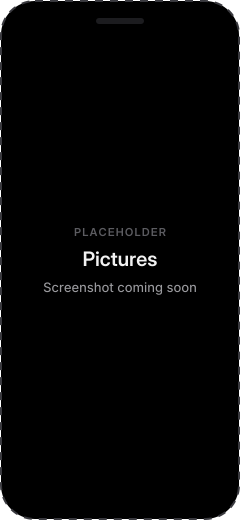
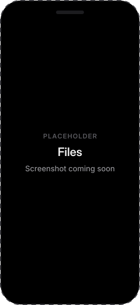
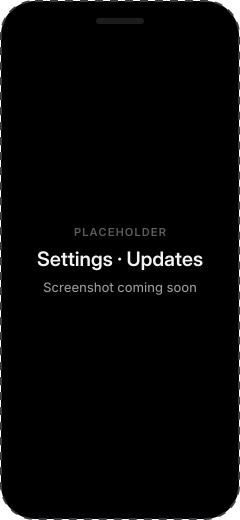

<!-- Hero: app icon, wordmark (light/dark), tagline and subtitle. Every image has alt text, so the page reads fine without images. -->
<p align="center">
  
</p>

<h1 align="center">
  <picture>
    <source media="(prefers-color-scheme: dark)" srcset="docs/assets/wordmark-dark.svg">
    <source media="(prefers-color-scheme: light)" srcset="docs/assets/wordmark-light.svg">
    
  </picture>
</h1>

<p align="center">
  <strong>Your saved videos and pictures, in a private, offline, TikTok-style feed.</strong>
</p>

<p align="center">
  A calm, true-black Android app with a swipe feed, a full movie player, a music player and a file manager.<br>
  It works fully offline. Your own Nextcloud, Subsonic, Jellyfin, SFTP or SMB server is optional.
</p>

<!-- Release badge: static while the repository is private. Once it is public, switch to the dynamic one:
     https://img.shields.io/github/v/release/PouryaFA81/Scrollback?style=flat-square&color=000000&label=release -->
<p align="center">
  <a href="https://github.com/PouryaFA81/Scrollback/releases/latest"></a>
  
  
  
  <a href="LICENSE"></a>
  
</p>

<p align="center">
  <a href="#download">Download</a> ·
  <a href="#screenshots">Screenshots</a> ·
  <a href="#features">Features</a> ·
  <a href="#roadmap">Roadmap</a> ·
  <a href="docs/guide/README.md">User guide</a> ·
  <a href="CHANGELOG.md">Changelog</a>
</p>

---

Saved clips pile up in a folder, and gallery apps make them hard to find or re-watch. Scrollback
indexes the folders you pick and plays them in a full-screen vertical feed, shuffled or in the order
you saved them, with likes, playlists, notes, tags and search. Your local folders never leave your
phone.

> **Status: v0.14.0, early.** Scrollback is a young project that runs on **Android 13 and newer**.
> Many features are new and still in early testing, especially the server connections, Watch
> (Jellyfin video), Nearby share and SMB. Please
> [report anything odd](https://github.com/PouryaFA81/Scrollback/issues/new/choose).

## Screenshots

<!-- SCREENSHOTS ON HOLD: new screenshots are coming. When they are ready, put them in docs/assets/screens/
     (feed, pictures, music, files, library, settings-updates; PNG or WebP, under ~300 KB, same size)
     and swap each placeholder src below for the real file. -->

<table align="center">
  <tr>
    <td align="center"><br><sub><b>Feed</b> · Random and Saved</sub></td>
    <td align="center"><br><sub><b>Pictures</b> · grid and viewer</sub></td>
    <td align="center"><br><sub><b>Music</b> · library and player</sub></td>
  </tr>
  <tr>
    <td align="center"><br><sub><b>Files</b> · built-in file manager</sub></td>
    <td align="center"><br><sub><b>Library</b> · likes, playlists, search</sub></td>
    <td align="center"><br><sub><b>Settings</b> · Updates</sub></td>
  </tr>
</table>

<p align="center"><sub>Screenshots of the current version are coming soon.</sub></p>

## Features

<table>
  <tr>
    <td width="33%" valign="top">
      <br>
      <b>Feed</b><br>
      Full-screen vertical feed with a <b>Random</b> (shuffled) and a <b>Saved</b> (newest or oldest first) view. Like, double-tap, share, speed 0.5× to 2×, loop or auto-advance, and resume where you stopped.
    </td>
    <td width="33%" valign="top">
      <br>
      <b>Pictures</b><br>
      A grid of the pictures in your folders, with a swipeable full-screen viewer.
    </td>
    <td width="33%" valign="top">
      <br>
      <b>Scrollback Player</b><br>
      A full movie player built on libVLC that plays almost any format. Swipe gestures, aspect modes, audio and subtitle tracks, subtitle styling, speed 0.25× to 4×, A-B repeat, picture-in-picture and background audio.
    </td>
  </tr>
  <tr>
    <td valign="top">
      <br>
      <b>Music</b><br>
      Songs, artists, albums, folders and playlists. Background playback with lock-screen controls, a mini player, shuffle, repeat and a queue. You can hide the tab.
    </td>
    <td valign="top">
      <br>
      <b>Watch</b><br>
      Movies and shows from your own <b>Jellyfin</b> server under <b>Library → Watch</b>: Continue watching, Next up, seasons and episodes, audio and subtitle tracks, and progress synced back to Jellyfin.
    </td>
    <td valign="top">
      <br>
      <b>Files</b><br>
      A built-in file manager: storage summary, categories, recent files, copy, move, rename, delete, share and search. Turn any folder into a Scrollback source.
    </td>
  </tr>
  <tr>
    <td valign="top">
      <br>
      <b>File tools</b><br>
      Under <b>Files → Tools</b>: a Markdown <b>Notes</b> editor, <b>Archives</b> (extract ZIP, TAR, 7z and more; compress to ZIP), an <b>Office</b> viewer for PDF, Word, Excel and PowerPoint with a CSV editor, and <b>Convert</b> with VERT.
    </td>
    <td valign="top">
      <br>
      <b>Network storage</b><br>
      Browse and manage <b>SFTP</b> and <b>SMB</b> servers, and stream their videos and pictures into your feeds. SFTP host keys are pinned on first use.
    </td>
    <td valign="top">
      <br>
      <b>Nearby share</b><br>
      Send and receive files over Wi-Fi with phones and computers running LocalSend or RSend. Encrypted, with Accept or Decline, an optional PIN, and no internet or account needed.
    </td>
  </tr>
  <tr>
    <td valign="top">
      <br>
      <b>Library</b><br>
      Liked, Playlists, History and Search across names, folders, notes and tags. Plus a duplicate finder and PIN-protected hidden items.
    </td>
    <td valign="top">
      <br>
      <b>Nextcloud</b><br>
      Sign in through your Nextcloud's own login page, stream folders into your feeds, download copies for offline use and sync likes, notes, tags, history and playlists.
    </td>
    <td valign="top">
      <br>
      <b>Self-hosted servers</b><br>
      Stream music from <b>Subsonic / OpenSubsonic</b> servers such as Navidrome, and from <b>Jellyfin</b>. Each server can have an alternate address, <b>Test connection</b> explains problems in plain words, and you can hide songs that are on more than one server.
    </td>
  </tr>
  <tr>
    <td valign="top">
      <br>
      <b>Privacy</b><br>
      Works offline, with no account. No analytics, no ads. Optional PIN lock, hidden items and a screenshot block. Server credentials are Keystore-encrypted.
    </td>
    <td valign="top">
      <br>
      <b>In-app updates</b><br>
      <b>Settings → Updates → Check for update</b> fetches the right signed APK for your phone, checks it and installs it. It only runs when you tap.
    </td>
    <td valign="top">
      <br>
      <b>Free and open source</b><br>
      Licensed under the <a href="LICENSE">GPL-3.0-or-later</a>. Third-party licenses are listed in the app under <b>Settings → About → Open-source licenses</b>.
    </td>
  </tr>
</table>

**Coming soon:** swipe between sub-tabs everywhere, an accurate HW/SW decoder label in Scrollback
Player, and more from the [roadmap](#roadmap).

The [user guide](docs/guide/README.md) explains every feature screen by screen.

## Download

<!-- Buttons link to the latest release page, because the APK file names carry the version number. -->
<p align="center">
  <a href="https://github.com/PouryaFA81/Scrollback/releases/latest"></a>
  <a href="https://github.com/PouryaFA81/Scrollback/releases/latest"></a>
  <a href="https://github.com/PouryaFA81/Scrollback/releases/latest"></a>
</p>

Get the APK from the [latest release](https://github.com/PouryaFA81/Scrollback/releases/latest).
Each release has three signed APKs, `scrollback-<version>-arm64-v8a-release.apk`,
`-armeabi-v7a-release.apk` and `-universal-release.apk`, plus a `SHA256SUMS` file.

**Which one do I pick?**

- **arm64-v8a**: most phones from the last several years. Start here.
- **armeabi-v7a**: older 32-bit phones.
- **universal**: works on any supported phone, but it's the biggest download. Pick it if you're not sure.

Since v0.13.0 the APKs include the libVLC libraries for Scrollback Player, so they are several times
larger than before. The release page lists the current size of each file. Scrollback Player isn't
available on x86 devices, such as most emulators.

To check a download, compare its SHA-256 with the line in `SHA256SUMS`
(for example `sha256sum scrollback-0.14.0-arm64-v8a-release.apk`).

> The repository is **private** for now, so these links only work for people with access until it
> goes public.

### Install

Open the APK on your phone and allow **Install unknown apps** for your browser or file manager when
Android asks. Scrollback needs **Android 13 or newer**. After that, you can update from inside the
app: **Settings → Updates → Check for update** ([how it works](docs/guide/updates.md)).

<details>
<summary><b>Install with adb</b></summary>

<br>

1. On your phone, turn on **Developer options → USB debugging** and connect it to your computer.
2. Download the APK for your phone from the [latest release](https://github.com/PouryaFA81/Scrollback/releases/latest).
3. Install it:

   ```bash
   adb install -r scrollback-0.14.0-arm64-v8a-release.apk
   ```

   `-r` keeps your data when you install over an existing copy.

Release builds install as **Scrollback** with the app id `app.scrollback`. Debug builds (every
build before v0.6.0, and the test APK attached to v0.6.0 to v0.8.0) use `app.scrollback.debug`. The
two are separate apps that can sit side by side, and each keeps its own library and settings.

To build the APK yourself instead, see [Build from source](#build-from-source).

</details>

<details>
<summary><b>Permissions explained</b></summary>

<br>

Every permission in the app's [manifest](app/src/main/AndroidManifest.xml), and why it is there:

| Permission | Why Scrollback asks for it |
|---|---|
| `INTERNET` | Only for the servers you add yourself (Nextcloud, Subsonic / OpenSubsonic, Jellyfin, SFTP, SMB, a VERT server), for Nearby share on your Wi-Fi, and for **Check for update**, which contacts GitHub only when you tap it. Everything else works without a network. |
| `ACCESS_NETWORK_STATE` | Lets the app tell whether you are online, so server features can wait quietly while you are offline. |
| `FOREGROUND_SERVICE`, `FOREGROUND_SERVICE_MEDIA_PLAYBACK` | Keep music, and Scrollback Player's background audio, playing as a media-playback service. |
| `FOREGROUND_SERVICE_DATA_SYNC` | Keeps a Nearby share transfer running, with a progress notification, while it is in progress. |
| `CHANGE_WIFI_MULTICAST_STATE`, `ACCESS_WIFI_STATE` | Let Nearby share find other devices on your Wi-Fi, only while the Nearby share screen is open or a transfer is running. |
| `ACCESS_LOCAL_NETWORK` | On Android 17 and newer, apps need this to talk to devices on your local network. Scrollback asks the first time you open Nearby share (Android shows it as **Nearby devices**). Once granted, it also covers SFTP, SMB and other servers on your home network. |
| `POST_NOTIFICATIONS` | Shows the media notification with play, pause and skip controls, and Nearby share progress. Android asks the first time it's needed. |
| `WAKE_LOCK` | Keeps playback running while the screen is off. |
| `REQUEST_INSTALL_PACKAGES` | Lets **Settings → Updates** install a new version. Android asks you to allow it the first time, and asks you to confirm every install. |
| `READ_MEDIA_VIDEO`, `READ_MEDIA_IMAGES`, `READ_MEDIA_AUDIO` | Used by the Files tab for categories and recent files. Asked only when you tap **Allow media access** on the Files tab. |
| `MANAGE_EXTERNAL_STORAGE` (All files access) | **Optional.** Lets the Files tab browse your whole internal storage like a regular file manager. Scrollback never requires it: the feeds, music and file manager all work with the folders you grant through Android's folder picker. |

The folders you add as sources are granted through Android's own folder picker (the Storage Access
Framework), which needs no extra permission.

</details>

<details>
<summary><b>Privacy</b></summary>

<br>

- **Works offline.** Your library, likes, notes, tags, playlists and history are stored on your
  phone. Nothing from your local folders is uploaded anywhere.
- **No tracking, no analytics, no ads.** Scrollback contains no analytics, crash-reporting or
  advertising libraries.
- **Network only when you ask.** Scrollback talks to the servers you add yourself, to nearby
  devices while Nearby share is open, to a VERT server when you convert a video, and to GitHub
  only when you tap **Check for update**. There are no background update checks.
- **Credentials stay protected.** Server passwords, keys and tokens, including the optional GitHub
  token, are encrypted with a key from the Android Keystore. They are never written to the app's
  database or logs. Your sign-in is only sent to the addresses you configured for that server.
- **Your PIN is never stored**, only a salted hash of it.
- **Android backup is turned off** for Scrollback, so its data is not copied into your device's
  cloud backups.

</details>

<details>
<summary><b>FAQ</b></summary>

<br>

**Does Scrollback need an internet connection or an account?**<br>
No. Everything except the optional servers, file conversion and the update check works offline,
with no account.

**Which Android versions are supported?**<br>
Android 13 and newer.

**My home server works on Wi-Fi but not over my phone's VPN.**<br>
If your VPN sends all traffic through the tunnel, it may not be able to reach your home network.
Turn on **LAN bypass** or **split tunneling** in your VPN app, or add the address that works there
as the server's **alternate address** in **Settings → Servers**. **Test connection** tells you which
address answers. See [Server connections](docs/guide/server-connections.md).

**The same song shows up twice.**<br>
That happens when two servers share one music folder. Turn on **Hide duplicates across servers** in
**Settings → Music** or **Settings → Servers**. Nothing is deleted. See
[Music and music servers](docs/guide/music-servers.md#hide-duplicates-across-servers).

**Check for update says no public release was found.**<br>
The repository is private for now. You can save a read-only GitHub token under
**Settings → Updates → GitHub token**, or wait until the repository is public. See
[Updating Scrollback](docs/guide/updates.md).

**Why does Scrollback mention "All files access"?**<br>
It's optional, for browsing your whole storage in the Files tab. Everything else works with the
folders you pick.

**Does removing a folder delete my files?**<br>
No. **Remove folder** only makes Scrollback forget the folder, along with its likes, notes and
playlist entries. Your files stay where they are.

**What license is Scrollback under?**<br>
The GNU General Public License v3.0 or later. See [License](#license).

**Is it on F-Droid or Google Play?**<br>
Not yet. An F-Droid / IzzyOnDroid build without All files access is on the roadmap.

More answers are in the [full FAQ](docs/guide/faq.md).

</details>

## Roadmap

From [ROADMAP.md](ROADMAP.md):

- [x] **0.1** Vertical feed, folders, saved items, playlists, PIN and hidden items
- [x] **0.2** File manager
- [x] **0.3** Nextcloud streaming, downloads and library sync
- [x] **0.4** Music player, Subsonic / OpenSubsonic and Jellyfin
- [x] **0.5** Five tabs, Settings behind the gear, glass chrome
- [x] **0.6** In-app updates and signed releases
- [x] **0.7** SFTP and SMB network storage
- [x] **0.8** Notes editor and archives, swipe between Library and Music sub-tabs
- [x] **0.9** Convert with VERT
- [x] **0.10** Office: PDF, Word, Excel and PowerPoint viewers, CSV editor
- [x] **0.11** Nearby share (LocalSend-compatible)
- [x] **0.12** Watch: Jellyfin movies and shows
- [x] **0.13** Scrollback Player, a full movie player
- [x] **0.14** Server connections, hide duplicates across servers, GPL-3.0-or-later
- [ ] **0.15** Polish: swipe between sub-tabs everywhere, size discipline, real HW/SW decoder label (coming soon)
- [ ] **Later** Feed and gallery upgrades, music depth (offline cache, lyrics, Android Auto),
  file-manager power features, a public repository, F-Droid and Persian localisation (coming soon)

## User guide

The full guide lives in [docs/guide](docs/guide/README.md): getting started, adding folders, the
feeds, Scrollback Player, likes and playlists, notes and tags, the PIN and hidden items, the
duplicate finder, the file manager and its tools, network storage, Nearby share, Nextcloud, music
servers, Watch, server connections, updates and an FAQ.

## Build from source

You need a JDK and the Android SDK. The Gradle wrapper is included.

```bash
./scripts/build-apk.sh              # debug APK, plus signed release APKs if keystore/ is set up
./scripts/build-apk.sh --install    # same, then installs with adb
./scripts/build-apk.sh --no-release # debug only (faster)
./gradlew testDebugUnitTest lint    # unit tests and lint
```

Release signing needs a local `keystore/` folder, which is never committed. Without it, the script
builds the debug APK only. Technical notes (stack, architecture, signing, streaming, sync, the
player, Nearby share, redirects and the design system) are in
[docs/DEVELOPMENT.md](docs/DEVELOPMENT.md).

## Contributing

Bug reports, ideas and pull requests are welcome. Please read [CONTRIBUTING.md](CONTRIBUTING.md) and
our [Code of Conduct](CODE_OF_CONDUCT.md) first.

## License

Scrollback is free software, released under the **GNU General Public License v3.0 or later**
(`GPL-3.0-or-later`). See [LICENSE](LICENSE) for the full text and [NOTICE](NOTICE).
Copyright (C) 2026 Pourya FA.

**Credits**

- **Scrollback is original code**, written from scratch for this project. No third-party app code
  is copied; SnapReel (MIT) was only a visual design reference.
- **Nearby share** is a Kotlin implementation of the open **LocalSend v2 protocol**. It was ported
  from Pourya FA's own **RSend** app and contains **no LocalSend source code**. It works with the
  official [LocalSend](https://localsend.org) apps; Scrollback isn't affiliated with LocalSend.
- **Third-party libraries keep their own licenses**, all compatible with the GPLv3. They include
  Apache-2.0 (AndroidX, Jetpack Compose, Media3, Kotlin, OkHttp, Coil, Haze, sshj, smbj, Apache
  Commons, Guava), MIT (Bouncy Castle, MBassador, SLF4J, Checker Framework), BSD-3-Clause
  (NanoHTTPD), 0BSD (XZ for Java) and LGPL-2.1-or-later (**libVLC**, shipped unmodified as
  dynamically linked, replaceable libraries; source at
  [code.videolan.org](https://code.videolan.org/videolan/vlc-android)). The full list with links is
  in [THIRD_PARTY_NOTICES.md](THIRD_PARTY_NOTICES.md) and in the app under **Settings → About →
  Open-source licenses**.
