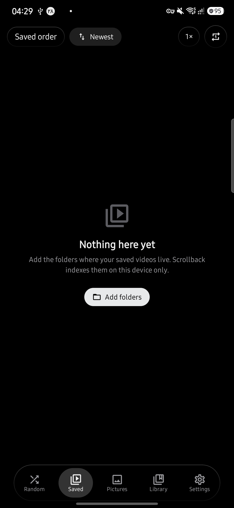
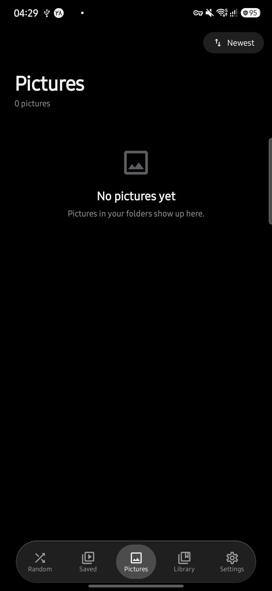
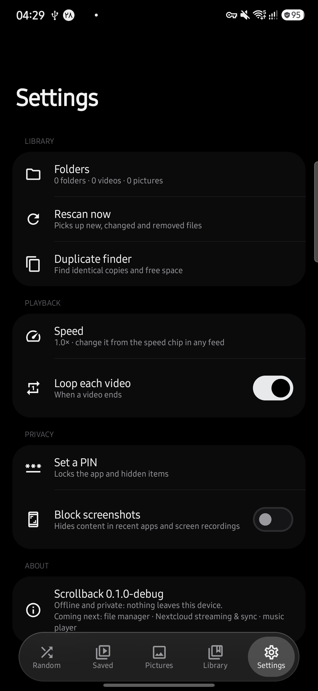

# Scrollback

**Your saved videos and pictures, in a private, offline, TikTok-style feed.**

Saved clips pile up in a folder, and gallery apps make them hard to find or re-watch. Scrollback
indexes the folders you pick and plays them in a full-screen vertical feed, shuffled or in the order
you saved them, with likes, playlists, notes, tags and search. It also has a built-in file manager
and a music player. If you run your own servers, you can connect Nextcloud, Subsonic-compatible
servers (such as Navidrome) and Jellyfin.

Your local folders never leave your phone. Server accounts are optional, and the app works fully
offline without them.

> **Status: v0.5.0, early.** Scrollback is a young personal project. It runs on **Android 13 and
> newer**. The features added in v0.2 to v0.5 (the file manager, Nextcloud, the music player and the
> server connections) are new and still in early testing. Please [report anything odd](#contributing).

## Contents

- [Features](#features)
- [Screenshots](#screenshots)
- [Install](#install)
- [Permissions](#permissions)
- [Privacy](#privacy)
- [Roadmap](#roadmap)
- [User guide](#user-guide)
- [Build from source](#build-from-source)
- [Contributing](#contributing)
- [License](#license)

## Features

### Feeds

- **Random** feed: a shuffled, full-screen vertical feed with a reshuffle button.
- **Saved** feed: your videos in the order you saved them, newest or oldest first.
- **Pictures**: a grid of your pictures with a swipeable full-screen viewer.
- A TikTok-style overlay: **like** (or double-tap), **save to a playlist**, **notes and tags**,
  **share**, and **info**. Tap to pause, drag the thin progress line to seek.
- **Playback speed** from 0.5× to 2×, and a choice between **looping each video** or
  **auto-advancing** to the next one.
- **Watch history** that remembers where you stopped and resumes from there.

### Library

- **Liked**, **Playlists** (create, rename, delete, reorder, play as a feed), **History** and
  **Search** across file names, folders, notes and tags, with tag chips to filter.
- **Duplicate finder** that spots byte-identical copies across your folders and deletes the extras
  only after you confirm.
- **Hidden items** that only show up after you unlock with your PIN.

### Privacy

- Optional **PIN lock** (4 to 8 digits) that re-locks the app after 30 seconds in the background.
- **Block screenshots**, which also hides the app's content in the recent-apps view and in screen
  recordings.

### File manager

- A **Files** tab with a storage summary, categories (Videos, Images, Audio, Documents, Downloads,
  Installation files), recent files and your folders.
- Breadcrumbs, list or grid view, sorting, multi-select, copy, move, rename, delete, new folder,
  search, share, open with, file info, and **Add source** to turn any folder into a Scrollback source.
- Works with the folders you grant by default. **All files access** is optional
  ([why](#permissions)).

### Music

- A **Music** tab with Songs, Artists, Albums, Folders and Playlists, plus Liked songs, Recently
  played and search. You can hide the tab in Settings.
- **Background playback** with a media notification and lock-screen controls, a mini player, a full
  player, shuffle, repeat and a queue.
- Music from your local folders, Nextcloud, **Subsonic / OpenSubsonic** servers (Navidrome,
  Nextcloud Music, Airsonic, Gonic and others) and **Jellyfin**.

### Servers (optional)

- **Nextcloud**: sign in through your Nextcloud's own login page, browse your files, stream folders
  straight into your feeds, download copies for offline use, and sync your likes, notes, tags,
  history and playlists between devices.
- **Subsonic / OpenSubsonic** and **Jellyfin**: stream your music library. Stars (Subsonic) and
  favourites (Jellyfin) stay in sync with your likes.

## Screenshots

| Saved feed | Pictures | Settings |
|---|---|---|
|  |  |  |

> These screenshots show an **earlier build (v0.1)**, before the v0.5 navigation rework. The bottom
> bar now has Feed, Pictures, Music, Files and Library, and Settings opens from the gear at the top.
> New screenshots are coming soon.

## Install

Scrollback needs **Android 13 or newer**.

**APK downloads on the Releases page: coming soon.** There are no signed release builds yet. For
now you can build a debug APK yourself and install it:

1. Build the APK (see [Build from source](#build-from-source)):

   ```bash
   ./scripts/build-apk.sh
   ```

   The APK is written to `dist/scrollback-debug.apk`.

2. Install it, either:
   - **With adb:** turn on *Developer options → USB debugging* on your phone, connect it, then run

     ```bash
     adb install -r dist/scrollback-debug.apk
     ```

     or let the script do both steps with `./scripts/build-apk.sh --install`.
   - **Without a computer connection:** copy the APK to your phone, open it with your file manager
     and allow *Install unknown apps* for that file manager when Android asks.

Debug builds install as **Scrollback** with the app id `app.scrollback.debug`. A future release
build will use `app.scrollback`. See [Updating Scrollback](docs/guide/updates.md) for how to update.

## Permissions

Every permission in the app's [manifest](app/src/main/AndroidManifest.xml), and why it is there:

| Permission | Why Scrollback asks for it |
|---|---|
| `INTERNET` | Only for the optional servers (Nextcloud, Subsonic / OpenSubsonic, Jellyfin). Scrollback connects only to servers you add yourself. Everything else works without a network. |
| `ACCESS_NETWORK_STATE` | Lets the app tell whether you are online, so server features can wait quietly while you are offline. |
| `FOREGROUND_SERVICE` and `FOREGROUND_SERVICE_MEDIA_PLAYBACK` | Keep music playing in the background, as a media-playback service. |
| `POST_NOTIFICATIONS` | Shows the media notification with play, pause and skip controls while music plays. Android asks the first time you start a song from the Music tab. |
| `WAKE_LOCK` | Keeps playback running while the screen is off. |
| `READ_MEDIA_VIDEO`, `READ_MEDIA_IMAGES`, `READ_MEDIA_AUDIO` | Used by the Files tab for the categories and recent files. Asked only when you tap **Allow media access** on the Files tab. Videos, images and audio only. |
| `MANAGE_EXTERNAL_STORAGE` (All files access) | **Optional.** Lets the Files tab browse your whole internal storage like a regular file manager, without picking folders one by one. Scrollback never requires it: the feeds, music and file manager all work with the folders you grant through Android's folder picker. You turn it on yourself in Android's settings, from the **Open permission settings** button on the Files tab. |

The folders you add as sources are granted through Android's own folder picker (the Storage Access
Framework), which needs no extra permission.

## Privacy

- **Works offline.** Your library, likes, notes, tags, playlists and history are stored on your
  phone. Nothing from your local folders is uploaded anywhere.
- **No tracking, no analytics, no ads.** Scrollback contains no analytics, crash-reporting or
  advertising libraries.
- **Servers are opt-in.** Scrollback only talks to the servers you add yourself. Library sync with
  Nextcloud is a per-account switch, and writes a single file (`/Scrollback/scrollback-sync.json`)
  to your own Nextcloud.
- **Credentials stay protected.** Server passwords and tokens are encrypted with a key from the
  Android Keystore. They are never written to the app's database or logs. For Nextcloud,
  Scrollback receives an app password that you can revoke at any time; for Jellyfin it keeps only
  an access token.
- **Your PIN is never stored**, only a salted hash of it.
- **Android backup is turned off** for Scrollback, so its data is not copied into your device's
  cloud backups.

## Roadmap

Done: the offline viewer (v0.1), the file manager (v0.2), Nextcloud (v0.3), the music player and
music servers (v0.4) and the new navigation (v0.5). See the [changelog](CHANGELOG.md) for details.

**Coming soon:**

- APK downloads on the Releases page, with signed release builds
- Jellyfin videos in the feeds
- Scrobbling for Subsonic servers
- Lyrics
- A Google Play-friendly version without All files access
- File conversion with [VERT](docs/guide/file-conversion.md)
- [In-app updates](docs/guide/updates.md)

## User guide

The full guide lives in [docs/guide](docs/guide/README.md): getting started, adding folders, the
feeds, likes and playlists, notes and tags, the PIN and hidden items, the duplicate finder, the file
manager, Nextcloud, music servers, updates and an FAQ.

## Build from source

You need the JDK (the project is set up for JDK 21) and the Android SDK. The Gradle wrapper is
included.

```bash
./scripts/build-apk.sh            # builds dist/scrollback-debug.apk (and keeps a copy in dist/archive/)
./scripts/build-apk.sh --install  # same, then installs it with adb
./gradlew testDebugUnitTest lint  # unit tests and lint
```

Plain Gradle works too: `./gradlew assembleDebug` writes `app/build/outputs/apk/debug/app-debug.apk`.

Technical notes (stack, architecture, how sync and streaming work, and the design system) are in
[docs/DEVELOPMENT.md](docs/DEVELOPMENT.md).

## Contributing

Bug reports, ideas and pull requests are welcome. Please read [CONTRIBUTING.md](CONTRIBUTING.md) and
our [Code of Conduct](CODE_OF_CONDUCT.md) first.

## License

**License: to be decided.** A license will be chosen before the repository goes public. Until then,
all rights are reserved.
