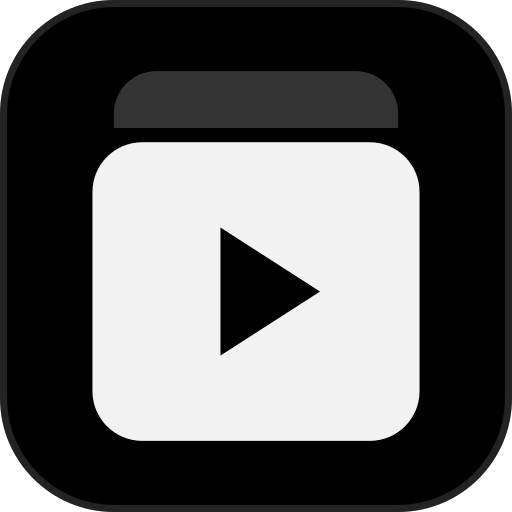
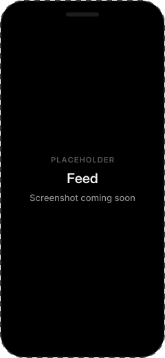

<!-- Hero: app icon, wordmark (light/dark), tagline and subtitle. Every image has alt text, so the page reads fine without images. -->
<p align="center">
  
</p>

<h1 align="center">
  <picture>
    <source media="(prefers-color-scheme: dark)" srcset="docs/assets/wordmark-dark.svg">
    <source media="(prefers-color-scheme: light)" srcset="docs/assets/wordmark-light.svg">
    
  </picture>
</h1>

<p align="center">
  <strong>Your saved videos and pictures, in a private, offline, TikTok-style feed.</strong>
</p>

<p align="center">
  A calm, true-black Android app with a swipe feed, a picture viewer, a music player and a file manager.<br>
  It works fully offline. Your own Nextcloud, Subsonic or Jellyfin server is optional.
</p>

<!-- Release badge: static while the repository is private. Once it is public, switch to the dynamic one:
     https://img.shields.io/github/v/release/PouryaFA81/Scrollback?style=flat-square&color=000000&label=release -->
<p align="center">
  <a href="https://github.com/PouryaFA81/Scrollback/releases/latest"></a>
  
  
  
  
  
</p>

<p align="center">
  <a href="#download">Download</a> ·
  <a href="#screenshots">Screenshots</a> ·
  <a href="#features">Features</a> ·
  <a href="#roadmap">Roadmap</a> ·
  <a href="docs/guide/README.md">User guide</a> ·
  <a href="CHANGELOG.md">Changelog</a>
</p>

---

Saved clips pile up in a folder, and gallery apps make them hard to find or re-watch. Scrollback
indexes the folders you pick and plays them in a full-screen vertical feed, shuffled or in the order
you saved them, with likes, playlists, notes, tags and search. Your local folders never leave your
phone.

> **Status: v0.6.0, early.** Scrollback is a young project that runs on **Android 13 and newer**.
> The file manager, Nextcloud, the music player, the server connections and in-app updates are new
> and still in early testing. Please [report anything odd](https://github.com/PouryaFA81/Scrollback/issues/new/choose).

## Screenshots

<!-- SCREENSHOTS ON HOLD: new screenshots are coming. When they are ready, put them in docs/assets/screens/
     (feed, pictures, music, files, library, settings-updates; PNG or WebP, under ~300 KB, same size)
     and swap each placeholder src below for the real file. -->

<table align="center">
  <tr>
    <td align="center"><br><sub><b>Feed</b> · Random and Saved</sub></td>
    <td align="center"><br><sub><b>Pictures</b> · grid and viewer</sub></td>
    <td align="center"><br><sub><b>Music</b> · library and player</sub></td>
  </tr>
  <tr>
    <td align="center"><br><sub><b>Files</b> · built-in file manager</sub></td>
    <td align="center"><br><sub><b>Library</b> · likes, playlists, search</sub></td>
    <td align="center"><br><sub><b>Settings</b> · Updates</sub></td>
  </tr>
</table>

<p align="center"><sub>Screenshots of the current version are coming soon.</sub></p>

## Features

<table>
  <tr>
    <td width="33%" valign="top">
      <br>
      <b>Feed</b><br>
      Full-screen vertical feed with a <b>Random</b> (shuffled) and a <b>Saved</b> (newest or oldest first) view. Like, double-tap, share, speed 0.5× to 2×, loop or auto-advance, and resume where you stopped.
    </td>
    <td width="33%" valign="top">
      <br>
      <b>Pictures</b><br>
      A grid of the pictures in your folders, with a swipeable full-screen viewer.
    </td>
    <td width="33%" valign="top">
      <br>
      <b>Music</b><br>
      Songs, artists, albums, folders and playlists. Background playback with lock-screen controls, a mini player, shuffle, repeat and a queue. You can hide the tab.
    </td>
  </tr>
  <tr>
    <td valign="top">
      <br>
      <b>Files</b><br>
      A built-in file manager: storage summary, categories, recent files, copy, move, rename, delete, share and search. Turn any folder into a Scrollback source.
    </td>
    <td valign="top">
      <br>
      <b>Library</b><br>
      Liked, Playlists, History and Search across names, folders, notes and tags. Plus a duplicate finder and PIN-protected hidden items.
    </td>
    <td valign="top">
      <br>
      <b>Nextcloud</b><br>
      Sign in through your Nextcloud's own login page, stream folders into your feeds, download copies for offline use and sync likes, notes, tags, history and playlists.
    </td>
  </tr>
  <tr>
    <td valign="top">
      <br>
      <b>Self-hosted music servers</b><br>
      Stream from <b>Subsonic / OpenSubsonic</b> servers such as Navidrome, and from <b>Jellyfin</b>. Stars and favourites stay in sync with your likes.
    </td>
    <td valign="top">
      <br>
      <b>Privacy</b><br>
      Works offline, with no account. No analytics, no ads. Optional PIN lock, hidden items and a screenshot block. Server credentials are Keystore-encrypted.
    </td>
    <td valign="top">
      <br>
      <b>In-app updates</b><br>
      <b>Settings → Updates → Check for update</b> fetches the right signed APK for your phone, checks it and installs it. It only runs when you tap.
    </td>
  </tr>
</table>

**Coming soon:** SFTP and SMB, a Markdown notes editor, archives, file conversion with VERT, an
Office viewer, a full movie player and Jellyfin video. See the [roadmap](#roadmap).

The [user guide](docs/guide/README.md) explains every feature screen by screen.

## Download

<!-- Buttons link to the latest release page, because the APK file names carry the version number. -->
<p align="center">
  <a href="https://github.com/PouryaFA81/Scrollback/releases/latest"></a>
  <a href="https://github.com/PouryaFA81/Scrollback/releases/latest"></a>
  <a href="https://github.com/PouryaFA81/Scrollback/releases/latest"></a>
</p>

Get the APK from the [latest release](https://github.com/PouryaFA81/Scrollback/releases/latest).
Each release has `scrollback-<version>-arm64-v8a-release.apk`, `-armeabi-v7a-release.apk` and
`-universal-release.apk`, plus a `-universal-debug.apk` for testing and a `SHA256SUMS` file.

**Which one do I pick?**

- **arm64-v8a**: most phones from the last several years. Start here.
- **armeabi-v7a**: older 32-bit phones.
- **universal**: works on any supported phone. Pick it if you're not sure.

To check a download, compare its SHA-256 with the line in `SHA256SUMS`
(for example `sha256sum scrollback-0.6.0-arm64-v8a-release.apk`).

> The repository is **private** for now, so these links only work for people with access until it
> goes public.

### Install

Open the APK on your phone and allow **Install unknown apps** for your browser or file manager when
Android asks. Scrollback needs **Android 13 or newer**. After that, you can update from inside the
app: **Settings → Updates → Check for update** ([how it works](docs/guide/updates.md)).

<details>
<summary><b>Install with adb</b></summary>

<br>

1. On your phone, turn on **Developer options → USB debugging** and connect it to your computer.
2. Download the APK for your phone from the [latest release](https://github.com/PouryaFA81/Scrollback/releases/latest).
3. Install it:

   ```bash
   adb install -r scrollback-0.6.0-arm64-v8a-release.apk
   ```

   `-r` keeps your data when you install over an existing copy.

Release builds install as **Scrollback** with the app id `app.scrollback`. Debug builds (the
`-universal-debug.apk`, and every build before v0.6.0) use `app.scrollback.debug`. The two are
separate apps that can sit side by side, and each keeps its own library and settings.

To build the APK yourself instead, see [Build from source](#build-from-source).

</details>

<details>
<summary><b>Permissions explained</b></summary>

<br>

Every permission in the app's [manifest](app/src/main/AndroidManifest.xml), and why it is there:

| Permission | Why Scrollback asks for it |
|---|---|
| `INTERNET` | Only for the optional servers you add (Nextcloud, Subsonic / OpenSubsonic, Jellyfin) and for **Check for update**, which contacts GitHub only when you tap it. Everything else works without a network. |
| `ACCESS_NETWORK_STATE` | Lets the app tell whether you are online, so server features can wait quietly while you are offline. |
| `FOREGROUND_SERVICE`, `FOREGROUND_SERVICE_MEDIA_PLAYBACK` | Keep music playing in the background, as a media-playback service. |
| `POST_NOTIFICATIONS` | Shows the media notification with play, pause and skip controls. Android asks the first time you start a song. |
| `WAKE_LOCK` | Keeps playback running while the screen is off. |
| `REQUEST_INSTALL_PACKAGES` | Lets **Settings → Updates** install a new version. Android asks you to allow it the first time, and asks you to confirm every install. |
| `READ_MEDIA_VIDEO`, `READ_MEDIA_IMAGES`, `READ_MEDIA_AUDIO` | Used by the Files tab for categories and recent files. Asked only when you tap **Allow media access** on the Files tab. |
| `MANAGE_EXTERNAL_STORAGE` (All files access) | **Optional.** Lets the Files tab browse your whole internal storage like a regular file manager. Scrollback never requires it: the feeds, music and file manager all work with the folders you grant through Android's folder picker. |

The folders you add as sources are granted through Android's own folder picker (the Storage Access
Framework), which needs no extra permission.

</details>

<details>
<summary><b>Privacy</b></summary>

<br>

- **Works offline.** Your library, likes, notes, tags, playlists and history are stored on your
  phone. Nothing from your local folders is uploaded anywhere.
- **No tracking, no analytics, no ads.** Scrollback contains no analytics, crash-reporting or
  advertising libraries.
- **Network only when you ask.** Scrollback talks to the servers you add yourself, and to GitHub
  only when you tap **Check for update**. There are no background update checks.
- **Credentials stay protected.** Server passwords and tokens, including the optional GitHub
  token, are encrypted with a key from the Android Keystore. They are never written to the app's
  database or logs.
- **Your PIN is never stored**, only a salted hash of it.
- **Android backup is turned off** for Scrollback, so its data is not copied into your device's
  cloud backups.

</details>

<details>
<summary><b>FAQ</b></summary>

<br>

**Does Scrollback need an internet connection or an account?**<br>
No. Everything except the optional servers and the update check works offline, with no account.

**Which Android versions are supported?**<br>
Android 13 and newer.

**Check for update says no public release was found.**<br>
The repository is private for now. You can save a read-only GitHub token under
**Settings → Updates → GitHub token**, or wait until the repository is public. See
[Updating Scrollback](docs/guide/updates.md).

**Why does Scrollback mention "All files access"?**<br>
It's optional, for browsing your whole storage in the Files tab. Everything else works with the
folders you pick.

**Does removing a folder delete my files?**<br>
No. **Remove folder** only makes Scrollback forget the folder, along with its likes, notes and
playlist entries. Your files stay where they are.

**Is it on F-Droid or Google Play?**<br>
Not yet. An F-Droid-friendly build without All files access is on the roadmap.

More answers are in the [full FAQ](docs/guide/faq.md).

</details>

## Roadmap

From [ROADMAP.md](ROADMAP.md):

- [x] **0.1** Vertical feed, folders, saved items, playlists, PIN and hidden items
- [x] **0.2** File manager
- [x] **0.3** Nextcloud streaming, downloads and library sync
- [x] **0.4** Music player, Subsonic / OpenSubsonic and Jellyfin
- [x] **0.5** Five tabs, Settings behind the gear, glass chrome
- [x] **0.6** In-app updates and signed releases
- [ ] **0.7** SFTP and SMB (coming soon)
- [ ] **0.8** Notes: a Markdown and plain-text editor (coming soon)
- [ ] **0.9** Archives: zip, tar and 7z (coming soon)
- [ ] **0.10** Convert files with VERT (coming soon)
- [ ] **0.11** Office lite: PDF, DOCX, XLSX, PPTX and CSV (coming soon)
- [ ] **0.12** Full movie player (coming soon)
- [ ] **0.13** Jellyfin video in a Watch section (coming soon)
- [ ] **Later** Swipe between sub-tabs, feed and gallery upgrades, music depth, file-manager power
  features, a public repository, F-Droid and Persian localisation

## User guide

The full guide lives in [docs/guide](docs/guide/README.md): getting started, adding folders, the
feeds, likes and playlists, notes and tags, the PIN and hidden items, the duplicate finder, the file
manager, Nextcloud, music servers, updates and an FAQ.

## Build from source

You need a JDK and the Android SDK. The Gradle wrapper is included.

```bash
./scripts/build-apk.sh              # debug APK, plus signed release APKs if keystore/ is set up
./scripts/build-apk.sh --install    # same, then installs with adb
./scripts/build-apk.sh --no-release # debug only (faster)
./gradlew testDebugUnitTest lint    # unit tests and lint
```

Release signing needs a local `keystore/` folder, which is never committed. Without it, the script
builds the debug APK only. Technical notes (stack, architecture, signing, streaming, sync and the
design system) are in [docs/DEVELOPMENT.md](docs/DEVELOPMENT.md).

## Contributing

Bug reports, ideas and pull requests are welcome. Please read [CONTRIBUTING.md](CONTRIBUTING.md) and
our [Code of Conduct](CODE_OF_CONDUCT.md) first.

## License

**License: to be decided.** A license will be chosen before the repository goes public. Until then,
all rights are reserved.
